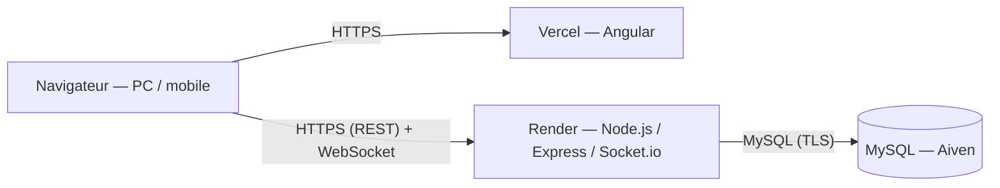

# 🔍 Murder Party — Poudlard 2027

Application web de **murder party en ligne**, jouable sur PC et mobile : rôles secrets, pouvoirs, indices physiques liés à des QR codes, messagerie piratable et fin de partie avec vote.
Conçue pour jouer avec des amis (12 à 15 joueurs, ~4 h) autour d'un scénario complet : *l'assassinat de la professeure Chourave, dans un Poudlard où la magie rencontre la technologie*.

[](https://github.com/TON-COMPTE/murder-party-app/actions/workflows/ci.yml)

**▶️ Démo : https://ton-projet.vercel.app** — *l'API gratuite se réveille en environ une minute au premier appel.*

## Fonctionnalités

- **Salon en temps réel** (Socket.io) et attribution des 15 personnages, avec les 3 meurtriers toujours inclus
- **15 pouvoirs** aux mécaniques variées : fausses conversations, falsification d'indices, duel avec vote, inversion des codes, panne réseau globale, fantômes et réanimation…
- **Messagerie** entre joueurs, avec piratage par code ou par pouvoir
- **Économie** : dons entre joueurs, questions payantes au MJ
- **Console du Maître du Jeu** : suivi des joueurs, questions de l'Alchimiste, QR codes imprimables
- **Fin de partie** : vote final, verdicts calculés selon l'objectif de chaque personnage, révélation de la solution

## Architecture



| Couche | Technologies |
|---|---|
| Frontend | Angular (composants standalone, signals, routing lazy, formulaires réactifs), TypeScript, SCSS |
| Backend | Node.js, Express 5, TypeScript, Socket.io, JWT, Sequelize |
| Base de données | MySQL |
| Qualité et déploiement | GitHub Actions (CI), Vercel, Render |

## Points techniques

- **Temps réel** : rooms Socket.io par partie, authentification JWT sur le handshake, contrôle d'appartenance avant d'écouter une partie
- **Intégrité des données** : transactions SQL avec verrous de lignes pour les dons et paiements (pas de double dépense), transitions d'état atomiques (`UPDATE … WHERE status = …`)
- **Événements chronométrés** (duels, pannes) : calcul d'état idempotent à la lecture, minuteurs serveur et reprise après redémarrage
- **Règles de jeu centralisées** et modifiables (`game.rules.ts`), calcul des verdicts isolé dans un module pur
- **Sécurité** : secrets de scénario réservés au MJ, `helmet`, limitation des tentatives de connexion, CORS configurable, validation des entrées

## Lancer en local

Prérequis : Node.js ≥ 22, MySQL.

```bash
# Backend
cd backend
cp .env.example .env      # puis renseigner JWT_SECRET et la base
npm install
npm run dev

# Frontend (autre terminal)
cd frontend
npm install
npm start
```

Le frontend tourne sur http://localhost:4200, l'API sur http://localhost:3000.

## Structure

```
backend/    API Express, modèles Sequelize, WebSocket
frontend/   Application Angular
shared/     Types TypeScript partagés
```
